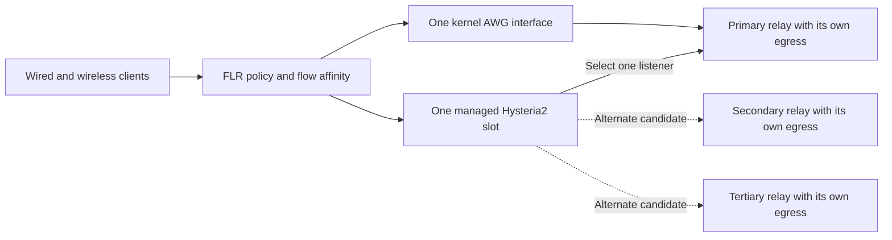

# FLR relay resilience and performance architecture

**Status** FLR 0.8 development, 2026-11-20. The source includes the first
phase, paired Hysteria qualification and an operator-run benchmark. Live
qualification and rollout are deployment work.

FLR and the operator's relays form one system. The router owns routing policy,
health decisions and flow affinity. Each relay owns its transport listeners,
egress, firewall and engine lifecycle. A release has to work across both halves
from the router's real WAN.

## Goals and boundaries

- Use kernel AmneziaWG for primary traffic and Hysteria2 for reserve. Keep
  production protocol overhead, CPU usage and latency unchanged when
  diagnostics and benchmarks are idle.
- Preserve healthy TCP and UDP flows when new flows change path. Maintain
  direct routing, LAN management, DNS behavior and the kill switch throughout.
- Resume new protected flows through any one qualified relay when at least
  one survives and remains reachable from the WAN. Changing egress IP or losing
  the old transport can still end flows that depended on it.
- Distinguish failure at the WAN, relay, transport and probe destination.
  Endpoint diversity covers some relay, provider and network failures. A
  local WAN outage or an access network that blocks all usable UDP remains
  outside that coverage.
- Measure goodput and tail latency on real paths before changing padding,
  queueing, hardware or hosting. Keep automatic selection based on
  qualification, policy and sustained health.
- Keep private profiles, credentials, endpoints, topology and receipts out of
  public artifacts. Keep public fixtures synthetic and deployment values in an
  operator-owned inventory.

FLR already provides an ordered connection registry, a native interface, one
managed proxy slot, bounded health history, a warm reserve and a flow-preserving
normal failback. Reuse those contracts. Start with observability and the
existing slots. Add a separately owned slot only if measurements justify the
cost and the required affinity invariants can be proved.

[Router API](ROUTER-API.md) · [Existing system design](MAX-PACKAGE.md) ·
[Engine update policy](ENGINE-UPDATES.md)

## FLR 0.8 implementation

- The controller records bounded candidate attempts, stage outcomes, probe
  timings and selection decisions. The diagnostics download includes them
  alongside the existing rounds and decisions. The AWG startup retry is
  limited to one retry within the original probe budget. AWG attempts can
  include the applied peer's handshake state and age bucket. Fresh attempts
  can also include RX/TX deltas when both local readings refer to the same
  peer revision and interface. These reads send no extra probe traffic.
- Auto uses the existing native interface and one Hysteria2 slot. Independent
  eligible profiles enter Auto through connection order. Qualification from
  the deployment WAN is required before relying on those profiles.
- The relay updater can pair an isolated listener with a router-side canary
  before and after production promotion. It needs a trusted private bridge,
  a fixed-port Hysteria2 profile and permission for the same-listener
  maintenance restart. [Paired updater](ENGINE-UPDATES.md#4-server-flr-engine-update)
- The opt-in benchmark measures HTTPS goodput and concurrent UDP from a
  wired client using an operator-owned fixture. [Relay benchmark](../server/relay-benchmark/README.md)
- The kernel affinity gate also exercises the ISP-first routing preset and
  kill switch. The synthetic controller matrix covers ingress outages.
  Endpoint diversity and performance claims still require deployment
  receipts. [Routing modes](ROUTER-API.md#routing-mode)
- Stable egress is optional. It lets one existing protected TCP or UDP flow
  keep its remote-facing address and port across an ingress carrier failure.

## Session-preserving failover through a stable egress

Ordinary affinity keeps each healthy flow on its original path. A flow that
loses a path with independent public NAT may need a new session. Stable egress
keeps one existing AmneziaWG tunnel (`flr_cont`) and its NAT state at the same
egress while FLR changes the carrier between the router and that egress.
Both carriers must be able to deliver UDP to the same anchor. For coverage of
an ingress-host outage, the anchor and its NAT must remain reachable after that
host fails.

Protected IPv4 flows in Full proxy and Tunnel modes use the stable interface.
This includes VPN DNS and the Games class. ISP-direct rules and LAN access
continue to follow the selected routing mode. New sessions in Direct mode use
the ISP. A carrier change swaps only the router's outer UDP forwarding socket.
The inner peer learns the outer source from authenticated packets. The router
and anchor retain the inner tunnel and flow state, including the public address
and port the application server sees.

Auto considers native AmneziaWG and UDP-capable Hysteria2 for this feature.
A measured round in which both providers lose HTTPS and UDP, or a missing
active carrier interface, can use a recently qualified alternate immediately.
Two consecutive missed echo checks to the anchor's inner address also trigger
carrier recovery, even when both Internet providers still respond. The check
uses the existing authenticated tunnel. A cooldown prevents immediate failback
to the failed carrier. Each AWG profile revision that lost the anchor stays
out of normal failback while a healthy alternate is serving. A qualified
Hysteria2 carrier can start forwarding anchored traffic while cleanup of a
failed AWG mark is pending. Returning to AWG still requires successful cleanup.
Cold candidates follow the normal ordered qualification.
Explicit connection and transport choices keep their existing scope. When no
compatible carrier is usable, protected flows pause and the kill switch holds.
The time to resume depends on detection, alternate readiness, and the next
inner packet or keepalive. Anchor loss, loss of its NAT state, an outage longer
than the application timeout, and moving flows into stable egress initially can
still end sessions. Qualification needs to exercise the actual anchor endpoint
over each eligible path.

### Optional configuration

The file `/etc/flr-runtime/continuity.json` opts in on controller start. Keep it
owner-managed with mode `0600` in the existing `0700` state directory. An example
configuration follows.

```json
{"bridge_port":41000,"tunnel_port":41001,"anchor":"203.0.113.50:41002","anchor_tunnel_ip":"10.66.0.1"}
```

- Supply an already configured, up AmneziaWG interface named `flr_cont` with a
  distinct IPv4 tunnel address, listen port `tunnel_port` and exactly one peer.
  The peer endpoint must be `127.0.0.1:bridge_port`, with `0.0.0.0/0` as the
  IPv4 AllowedIPs and persistent keepalive enabled. Use an interval that fits
  the intended recovery time for idle and receive-only flows. Keep this
  interface out of the main default route and leave policy table 774 to FLR.
- Use a dedicated firewall zone for `flr_cont` with LAN forwarding, router
  output, established/related return traffic and suitable MTU/MSS handling.
  Restrict unsolicited traffic. FLR supplies stable IPv4 LAN masquerade on
  `flr_cont`. Set the inner MTU to fit both carriers plus the inner protocol
  overhead and verify it under load.
- The anchor terminates the same peer on one fixed UDP endpoint and provides
  forwarding with a stable public IPv4 egress and persistent NAT mappings.
  Its inner IPv4 address (`anchor_tunnel_ip`) must answer ICMP echo from the
  router over that peer. FLR uses the router runtime's raw socket permission
  for the check. Qualify both relays' UDP reachability to the endpoint.
  Keep peer and firewall configuration in private operator-managed state.

FLR uses the existing peer and keeps configuration optional. It checks the
local interface, listen port, loopback endpoint and keepalive at startup. The
administrative status exposes only whether protected classes use stable egress
and the selected carrier. Direct startup needs no anchor. When leaving Direct
after such a startup, FLR checks the optional configuration before changing the
applied routing mode. Deploying and reverting the configuration changes egress
for protected traffic and needs a maintenance window.

### Deployment acceptance

From a wired LAN client, hold one continuous TCP stream and one bidirectional
UDP exchange against a controlled endpoint. Record their remote-facing source
address and port, TCP connection identity, and UDP sequence. Remove the active
ingress while traffic is running and observe recovery on a previously qualified
alternate. Repeat in both directions, including receive-only traffic and a
short all-path outage. Require the same sockets, source address and per-flow
ports, no TCP reconnect or reset, and record packet loss, longest gap, latency
and goodput. Repeat over the deployment WAN and under representative load.
Record separately which tests used a warm carrier, cold candidate, or physical
link loss. The isolated kernel and relay unit tests cover routing and bridge
invariants, while deployment acceptance exercises the actual carriers and anchor.

## Path ownership



The solid links show a typical primary and colocated warm reserve. Either
independent candidate can own the Hysteria2 slot once qualified. An alternate
ingress that forwards through the primary cannot recover from loss of the
primary relay.

## Controller health and session continuity

The router uses native kernel AmneziaWG (AWG) as its preferred path and UDP Hysteria2
as its reserve. The controller owns selection and the marks, routes and conntrack
entries that carry traffic. Changing the default changes the channel assigned to new
flows. Established flows keep their channel while its owner and forwarding path
remain healthy. An AWG and a Hysteria2 profile can run together. AWG profiles share
one native interface and mark, and imported Hysteria2 profiles share one proxy
process slot, TUN and route ownership. [Connection
selection](../runtime/internal/transport/connections.go) · [Slot
retirement](../runtime/internal/transport/continuity.go) · [Dataplane
publication](../runtime/internal/dataplane/nft.go)

### Per-attempt evidence

Extend the existing local diagnostic history with bounded attempt records so a round
that tries several candidates preserves the outcome of each one. Use the boot ID, a
controller instance ID and a monotonically increasing attempt sequence to join each
record to its selection generation, reason and publication decision. Stages carry
elapsed durations from a monotonic clock and a fixed outcome such as `ok`, `failed`,
`timeout`, `budget_exhausted`, `cancelled`, `superseded` or `unavailable`. Use
`not_run` for a stage that never started. Counters track discarded records. Keep the
existing shared size and page limits (4 MiB total and 32 KiB per page), include
attempts in eviction accounting, and cap attempt count and subdivisions per record.
[Diagnostic history](../runtime/internal/diagnostic/history.go) · [Controller
diagnostics](../runtime/internal/controller/diagnostics.go)

| Proposed evidence | What to retain |
| --- | --- |
| Candidate and clock | Locally assigned opaque candidate and revision references, transport family, attempt reason and sequence, monotonic start offset and duration, wall-clock sanity as `sane`, `suspect` or `unknown`. Sample any available local time-sync status and detect wall-clock steps against elapsed time. |
| Apply and link | Outcomes and elapsed times for old-owner retirement, native apply or engine start, and route installation. Record interface or process readiness separately. Include age and availability of the latest WAN link, carrier and default-route observation. |
| Handshake and traffic counters | For the currently applied AWG peer, record `none`, `fresh`, `stale` or `unknown` and an age bucket when the clock supports it. Optional RX/TX deltas use two reads from the same applied revision. Use `unavailable` when an engine has no equivalent signal. |
| HTTPS and UDP | For each already configured probe target, retain fixed target indexes, validated HTTPS and UDP outcomes and elapsed times. Record both sub-attempts when the bounded startup retry runs, with one result fed into health evaluation. Keep WAN control probe evidence separate from the tunnel results. |
| Selection and publication | Retain previous owner, proposed owner, last applied selection and publication outcome, plus whether the reserve remained running. A generation change during an attempt marks the sample superseded. A failed publication leaves the last confirmed selection visible and reports the pending action. |

Add the attempt records as an optional diagnostics extension. Keep existing decision
and round fields and the cursor contract backward-compatible. An allowlist of fixed
enums, numeric values and opaque identifiers defines the record and export. Probe
responses, packet contents, endpoint addresses and ports, hostnames, peer keys,
profile and site names, raw commands and engine output stay outside this schema.
Reuse the existing local diagnostic API and its storage limits. Telemetry reuses the
current probe cadence and wire traffic, including the existing warm-probe budget.
Collect local state within the current operation budget. Startup evidence can explain
an ambiguous result even when the clock is suspect. Elapsed deadlines and cooldowns
use monotonic time. The health decision uses transport readiness and validated tunnel
traffic. A recent handshake or moving byte counters alone cannot qualify a path.
[Native backend](../runtime/internal/transport/native_awg.go) · [Path
probes](../runtime/internal/health/probe.go) · [WAN
diagnostics](../runtime/internal/diagnostic/wan.go)

### Phase 1 with the existing proxy slot

Keep the current auto-mode policy. Prefer AWG on startup and during native recovery.
If the active AWG fails and the warm Hysteria2 reserve qualifies, publish the reserve
for new flows without a second start. If the reserve is unavailable, use the existing
bounded ordered sweep and cooldowns. While Hysteria2 carries new flows, probe the
applied native owner and retry higher-ranked AWG candidates in order, at most one
native replacement per round. A healthy, recovering or unmeasured native owner keeps
its identity. On qualified AWG recovery, publish AWG for new flows and leave the
running Hysteria2 owner in place with its process, TUN, routes and conntrack.
Recovery can qualify using the existing health windows and clean measurements. Hard
failure may require retiring a failed channel and its broken sessions. [Warm reserve
and re-advance](ROUTER-API.md#warm-reserve) · [Native
recovery](../runtime/internal/transport/readvance.go) · [Health
policy](../runtime/internal/health/degradation.go)

For protection against a shared-IP or provider outage, qualify ingress on a different
IP and announced prefix. Prefer a different provider, upstream and facility. Record
the independence actually verified. It must also have an egress that survives loss of
the primary site. Using a different UDP port or protocol on the primary IP covers a
transport-specific failure at that site. A second address in the same announced
prefix or a second ingress that forwards through the failed site still shares
relevant failure modes. All candidates share the router WAN. Keep failure-domain
information in the operator's deployment inventory and express the phase 1 preference
through the existing connection order. For example, a deployment can use
`203.0.113.10` for primary AWG and `198.51.100.20` for independent Hysteria2. Put
independent Hysteria2 first in the Hysteria2 order if immediate fallback on loss of
the primary IP matters most. If same-site Hysteria2 is first, the independent site is
a cold candidate and can start only after the current slot retires safely. A healthy
reserve carrying older sessions stays in its slot on failback or order changes. Port
and MTU settings remain operator-controlled and the design adds no port or MTU
adaptation. [Connection order](../runtime/internal/connection/order.go) · [Warm
admission](../runtime/internal/transport/warm.go)

| State or failure | Selection and resource handling |
| --- | --- |
| Hard AWG failure with a healthy warm reserve | Retire failed AWG affinity as required, publish the reserve for new flows and retain the same reserve process. For a soft performance fallback, preserve live AWG resource ownership and affinity while traffic still flows. |
| Same ingress IP loses both transports | If the independent reserve is warm and valid, publish it. If the shared-IP Hysteria2 slot fails, quiesce the old channel and safely retire its conntrack and process before trying the independently placed candidate. |
| Native replacement cleanup fails | Keep the AWG mark unavailable for replacement. Retry cleanup for the same native candidate once on the next sweep before skipping the shared AWG mark and allowing the independently owned proxy path to qualify. A controller publication failure or hard-failure conntrack cleanup remains pending and is retried through the controller’s existing path. |
| Fresh native apply is successful but traffic is late | Record apply, interface and handshake evidence separately. The planned fresh-apply qualification retry waits 300 ms if a measured failure leaves room under the original probe deadline. Submit a single result to the evaluator. A superseded or cancelled attempt cannot publish a selection or count towards recovery. |
| Background Hysteria2 standby startup fails, is superseded, or never qualifies | Adopt a standby only for the current generation and candidate after qualification. A never-selected standby stops without clearing conntrack. Quarantine a slot when stop fails and retry before reuse. |
| Hysteria2 retirement fails after carrying sessions | Hold the old ownership and mark through both conntrack cleanup and process stop. Keep any healthy unaffected owner in service and expose cleanup as pending. |
| All eligible paths are unavailable | Publish `down` for VPN traffic classes. Keep the existing LAN and direct paths reachable and preserve the kill switch. |

### When a second Hysteria2 slot is needed

Two Hysteria2 production processes must run simultaneously to prewarm both sites or
switch new flows to an independent site while the first Hysteria2 owner still carries
sessions. A loopback-only traffic canary can run separately from the production
slots. That requires an additional separately owned process, TUN, SOCKS and probe
endpoint, channel mark, routing tables and endpoint pins. Selection must publish
distinct per-flow owners and retirement must remove only the departing slot's state.
Startup, stale-state recovery, rollback, manual tests, diagnostics and device policy
must all understand both slots before that layout can carry traffic. Even with two
slots, a connection pinned to a failed site can break. It may reconnect on a
different egress. [Process and route
ownership](../runtime/internal/transport/process.go) · [Route
pins](../runtime/internal/transport/pins.go) · [Channel
marks](../runtime/internal/contract/contract.go)

### Regression checks

- Simulate start, cleanup, time and publication outcomes independently. Verify that a fresh native startup retry fits the original budget and contributes one health sample. Verify that a first native replacement cleanup failure retries the same candidate and a second lets the proxy sweep proceed. Cancel or supersede slow warm admission and assert that AWG monitoring continues on schedule and no stale worker publishes or reuses the slot. [Transport tests](../runtime/internal/transport/manager_connections_test.go) · [Warm tests](../runtime/internal/transport/warm_test.go)
- In disposable Linux namespaces, open long-lived TCP and UDP flows on Hysteria2, recover AWG, then open fresh flows. Assert that both original flows still exchange traffic over Hysteria2, fresh flows select AWG, and the reserve sees zero stop, restart or conntrack-clear operations. Hold a failed stop or cleanup and assert zero reuse of the mark until both succeed. Inject a fault affecting both transports on the same ingress and verify that only a qualified independent ingress can take over. Repeat with every ingress unavailable and verify the VPN kill switch and continued LAN and direct reachability. [Continuity tests](../runtime/internal/transport/continuity_test.go) · [Linux namespace harness](../ci/session-continuity.py)
- Exercise a clock step, an unsynchronized start, endpoint-independent probe loss and a saturated diagnostic history. Check that stage timing and cooldown ordering remain monotonic, missing measurements never qualify a path, stale generations cannot publish, the record and page bounds hold, and exports contain none of the injected identifiers or payloads. [Diagnostic tests](../runtime/internal/diagnostic/history_test.go)
- Accept a deployment only after tests from the router's WAN. Bind outer traffic to the selected WAN and verify the observed interface when needed. On each selected ingress run concurrent HTTPS transfer and sequenced bidirectional UDP for a pre-agreed sustained window such as 60 seconds. Record transfer completion, UDP loss, jitter and recovery interruption against deployment thresholds. During failback keep the original TCP and UDP flows on the healthy reserve and establish new flows on AWG during the same test window. Capture only the measurements needed for the acceptance record.

## Performance and controlled-path benchmark

### Responsibilities and traffic

Use an operator-owned fixture that serves a bounded HTTPS object and answers
test UDP requests. Keep it local to the relay or restricted to an approved
measurement source. An optional direct comparison may use a separately approved
listener on that same relay. Use a fixed target set so the fixture cannot relay
arbitrary traffic. Store test configuration outside the shipped policy. Start
benchmarks explicitly and stop them after the
run deadline, with bounded bytes, concurrency, and output. A normal health
round must never run a bulk benchmark.

For transport isolation, reach the relay fixture through its tunnel and over a
direct path to the same host where reachable. For egress evaluation, use a second
controlled destination that is common to the compared relays. Prove the selected
underlay, tunnel and egress with route and counter evidence. Generate sustained
load from a wired LAN client when testing production forwarding, and verify
that the outer packets leave on the router's real WAN. Use the router itself
for the smaller compatibility canary. Running a bulk traffic generator on
the router can make its own CPU consumption look like a forwarding limit.

### Repeatable run

| Phase | Work | Record |
| --- | --- | --- |
| Baseline | Check the quiet path, clocks, link negotiation, actual MTU and the selected route. Record idle game-target RTT and a controlled UDP probe. | WAN, relay and endpoint labels, time, build and engine hashes, target class, idle p50/p95/p99 RTT, loss and jitter |
| Throughput | Run 60–120 seconds in each direction with one and four streams. Alternate control and candidate in the same time window. Repeat at least three matched runs before treating an apparent gain as repeatable. | Total delivered payload, goodput, stall time, per-run variance, TCP retransmits and UDP loss |
| Loaded latency | Sample the same game target and controlled UDP target during upload and download load. Include a quiet period between runs. | Busy p95/p99 RTT, increase over idle, jitter, loss and timeout count |
| Resource evidence | Sample router and relay together. | Per-core CPU and softirq, VPS CPU steal, NIC and socket drops, qdisc backlog and drops, errors, observed packet size and fragmentation |
| Interpretation | Compare matched protocols, relay locations and profiles one change at a time. | Tunnel/direct goodput ratio per direction, latency deltas, saturation evidence and missing comparisons |

The benchmark includes a local router and relay counter sampler and an offline
comparison of matched client receipts. The sampler reports CPU, link, TCP/UDP,
fragmentation and available root qdisc counters over the measured window. The
comparison reports goodput ratios and UDP deltas and keeps the HTTPS duration
and budget evidence for each pair. [Benchmark tools](../server/relay-benchmark/README.md#collect-router-and-relay-counters)

Record every failed run and label an unavailable direct comparison. ICMP on a
game route is a latency indicator. Controlled UDP and application success
supply independent evidence. Keep diagnostic references to public probes as
targets only. Send user traffic and measurement data only on their intended
paths.

Use matched results to choose the next experiment:

- If router CPU or packet handling saturates, test packet steering and queue
  configuration first. Qualify any fast-path change against marks, DNS, route
  policy, connection tracking, and the kill switch.
- If captures and counters indicate fragmentation or a path MTU problem, find
  a working payload bound with actual profile overhead. Verify both small UDP
  traffic and sustained transfer before promoting an MTU change.
- If the VPS or its upstream saturates, compare a qualified alternate relay.
  Host port labels and nearby speed-test results are baseline context.
- If queueing drives the latency tail, compare the existing optional AWG CAKE
  setting using measured rates. Report both the latency benefit and any
  throughput or CPU cost.
- For Gecko/Salamander, compare cold connection and reconnect success as well
  as data-plane throughput on the same route. Test BBR as the reference before
  considering a fixed Hysteria2 bandwidth policy.

[Existing queueing control](ROUTER-API.md#tunnel-queueing-cake) ·
[Hysteria2 protocol](https://hy2.app/docs/developers/Protocol/) ·
[Datagram path MTU discovery](https://www.rfc-editor.org/rfc/rfc8899.html)

## Paired engine qualification and promotion

Today the router's isolated engine canary tests the real WAN with an HTTPS
transfer and UDP. The server updater starts a candidate process, then checks
actual router traffic after switching the production service. Move that server
reachability check ahead of production promotion while keeping the post-change
check.

| Step | FLR | Relay |
| --- | --- | --- |
| Stage | Keep production policy and flows. Use a bounded local candidate session with an exact proposed profile. | Stage the verified binary and a candidate listener with independent bind, stats and process ownership. Keep production endpoints and certificates serving. |
| Qualify | Verify ownership and route. Require the existing floor of at least 8 MiB HTTPS within 60 seconds and at least three UDP DNS answers from the real WAN. | Confirm the same attempt reached the intended candidate listener and transferred bytes in both directions. Associate only private, per-listener counters with the attempt. |
| Compare | If the candidate fails, test the current version and retry the candidate in a comparable window. | Treat a shared path failure, changed configuration, cancellation or absent receipt as inconclusive. Use the existing compatibility lock for a reproducible regression. |
| Promote | Use the normal policy owner to publish qualified paths for new flows. | Promote one relay or listener at a time with an atomic local state record and last-good artifacts. Keep the old serving process until traffic is clear or the maintenance decision is explicit. |
| Verify | Repeat traffic qualification and observe healthy active and reserve paths. | Verify bytes and process ownership, then finish or restore last good. An interrupted attempt resumes from the recorded stage and reconciles actual running processes. |

Candidate endpoints must have the same cryptographic settings and protocol
behavior as the intended production listener unless the changed setting is the
one being tested. A different candidate port or address can change WAN
reachability. Record that difference and repeat checks on the final endpoint
after promotion. Preserve the separate site and tunnel certificate roles.
Per-listener checks include bound protocol, service ownership, certificate
validity and expiry, and expected firewall scope. Keep counters and control
interfaces private. A candidate receipt is valid for its router build,
candidate binary hash, profile revision, relay and listener identity, and
expiry window. Receipt data does not become routing authority.

Extend the existing local compatibility lock and canary interfaces. The relay
can continue its current check-only operation until paired qualification is
available. Keep stable latest-compatible policy and the existing pinned
sing-box exception. No simultaneous router and relay engine promotion is
needed for the first rollout.

[Router canary code](../runtime/internal/engineupdate/canary.go) ·
[Server updater](../server/engine-update/README.md) ·
[Current update contract](ENGINE-UPDATES.md#4-server-flr-engine-update)

## Implementation and release sequence

| Work | Owning code | First acceptance gate |
| --- | --- | --- |
| Add per-profile attempt evidence | `runtime/internal/transport`, `runtime/internal/health`, `runtime/internal/diagnostic`, status and LuCI consumers | A failed primary probe remains visible after a successful fallback. Old settings and diagnostics consumers still work. |
| Add private benchmark and controlled fixtures | Reuse router canary transport seams. Add a separate operator-invoked harness and fixture configuration. | Matched traffic measurements and both-end counters. No route, firewall, DNS or profile mutation in a benchmark. |
| Qualify independent recovery paths | Existing registry, reserve management, diagnostic code and kernel affinity tests | A surviving, qualified site accepts new TCP and UDP when the others fail. Healthy flows on a retained slot survive recovery. |
| Pair relay promotions | `runtime/internal/engineupdate` and `server/engine-update` | A bad candidate cannot promote. A shared failure stays inconclusive. Interruption at each stage leaves a coherent last-good state. |
| Switch the carrier under a stable egress | `runtime/internal/continuity`, transport manager, controller and dataplane | TCP and UDP on the stable egress retain their original tuples across loss and restoration of a carrier. |

Unit tests cover probe outcomes, reused generation tokens, slot ownership,
selection ordering, and rollback. CI exercises a synthetic outage matrix and
the existing Linux connection-affinity gate. Use fixtures for delayed or
invalid time, missed first data probes, outright endpoint loss, sustained
stalls, and direct-path failure. Actual promotion also requires router-side
HTTPS and UDP evidence from the deployment WAN, a controlled fallback and
failback, and a saved-state recovery check. Record observed recovery times and
performance on the same wired setup before claiming an improvement.

A release should preserve the configured healthy path when optional features
are disabled. Roll out diagnostics first, run the benchmark on the existing
fleet, then qualify independent reserves and paired promotions. Keep the
previous controller or image and a current verified configuration backup
available for rollback. Hardware flashing, new services and changes to the
operator's live network follow the applicable approvals.

[Kernel affinity validation](../ci/session-continuity.py) ·
[Router recovery guide](RECOVERY-0.6.ru.md)
